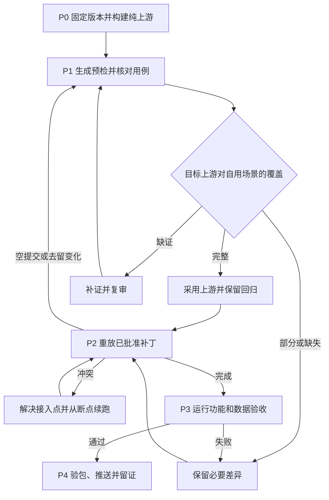

# 上游升级与自研差异持续维护方案

这份手册用于维护 XLSX、CSV、TSV、Markdown Editor 的个人 Fork。接手人从个人仓库取已验收的来源，在原作者的目标版本上保留仍有价值的个人差异，并凭可复查的证据发布候选版。

## 一页纸结构化总览

**默认方案为固定上游 SHA、按场景复核、按功能选择性重放，再做数据保真和交付验收。** 当前可用于演练的发布是个人版 `2.1.0`，其上游为 `v2.0.9`，固定提交为 `f448b8d23f6a3f84743b70baaff287ba856b4370`。

| 接手时的问题 | 处理办法 |
| --- | --- |
| 从哪份代码开始 | 从个人候选分支取得维护工具和已验收补丁，从原作者仓库取得目标 tag。记录旧上游、旧个人源码和新上游三个完整 SHA。 |
| 哪些功能要迁 | 用同一使用场景验证目标上游，完整覆盖就采用上游，部分覆盖就只补缺口，个人独有行为继续保留。旧配置、存储和失败路径也属于使用场景。 |
| 工具能做什么 | `plan` 比较清单和文件触点，`prepare` 按人工批准的顺序重放，遇到冲突保存断点。构建、回归和 VSIX 打包使用现有独立命令。 |
| 卡住时怎么继续 | 先定位当前 SHA 和 `Feature-ID`，在候选工作树处理冲突与对应回归。沿用同一计划续跑。功能取舍变化时开一轮新候选。 |
| 什么时候可以交付 | 关键功能和保存门禁通过，VSIX 可追溯到构建源码，远端 SHA 已核对。逐个 IDE 记录安装、实际加载和编辑落盘的证据与待验项。 |
| 交给下一位什么 | 功能台账、这轮去留计划和试验记录、候选 Git 提交、VSIX 与哈希、验收结果和可回装的旧包。 |



## 1. 推荐方案与取舍

采用四份方案各自最有用的一段。前一轮 Codex 方案提供由上游基线、Git 功能补丁和 VSIX 组成的交付主线。DS 提供清单与文件的预检思路。CC特朗普提供行为探针，即小而可重复的使用场景用例。CCchrome178 提供定位冲突、在新上游落位并立即回归的操作规程。

这四段通过同一个 `Feature-ID` 对接。台账说明用户为什么需要该能力，预检找到要复审的触点，行为证据决定去留，Git 提交保留需要重放的代码，回归验证候选中的实际结果。概念上的“上游从 10 项增至 15 项并覆盖 2 项个人能力”最终会留下 15 项上游加 1 项自研。核对的个人场景仍有 3 项，实际需要迁移的实现只有 1 项。

| 顺位与选项 | 价值 | 成本和复杂度 | 风险、依赖和影响范围 |
| --- | --- | --- | --- |
| **1．选定组合**。清单预检、行为判断、Git 选择性重放和分层验收 | 同时省掉重复找差异、机械搬运和部分重复验证，保留逐项退役的能力 | 首轮要整理功能归属、配置和用例。之后复用 Git、Node 和现有测试 | 薄弱的探针仍会误判，需要正反对照和真实落盘。改动限于本轮候选及共用接入点 |
| 2．功能提交加已有回归，由人挑拣和处理冲突 | 工具故障时可以在独立候选里手工接管 | 上手快，清单和共享文件要人工查 | 适合少量、边界清楚的改动。上游重构时容易漏看默认值、资源或依赖 |
| 3．DS 式清单和热点预检，迁移仍由人处理 | 快速看清改到哪里、先审什么 | 报告成本低，自动合成配置会引入额外维护 | 同名键和文件重叠只能提示风险。原型历史结果只可用于挑选检查点 |
| 4．线性栈加 `rebase --onto` 或 `rerere` | 所有补丁均确认保留、重复冲突较集中时能省操作 | 要额外维护栈边界及冲突缓存 | 整栈处理退役项、部分覆盖和共享依赖容易出错。只在独立试验分支使用 |
| 5．完整探针、配置合成、接入点重构和 CI 一次上线 | 自动化覆盖最多 | 同时维护探针、生成规则、执行状态和 CI 环境 | 假通过更难定位，跨 IDE 和用户数据仍需专项证据。用真实升级的耗时和失败分布决定优先级 |

旧 `2.0.9-local.9` 的代码、用户配置和用例用来追溯。强行让新候选树与旧版完全相等会锁住本轮要淘汰的实现。整栈重放后自动跳过空提交会漏核行为和依赖。清单全量取并集会带回退役命令、设置和依赖。整仓抽象、持续集成和配置生成器一起改，会同时引入多个故障源。当前交付沿用小入口，必要时从已验收 Git 提交导出补丁。

## 2. 执行前的全局规划与阶段验收

启动前确定本轮目标版本、需要保留的使用场景、目标 IDE、涉及的文件格式和可回装的版本。维护者对功能取舍和放行负责。Agent 可以生成差异与执行用例，提交计划时附上可复查的代码、命令和结果。接手人先跑通返回顶部、工具栏布局、Markdown 分屏保真三类试点，再按相同规则处理其余能力。三项分别练习采用上游、保留自研和只补缺口。

| 阶段 | 目标与执行步骤 | 产出及通过条件 | 失败后 |
| --- | --- | --- | --- |
| **P0 固定输入** | 核对旧包、旧源码、旧上游和目标 tag。在独立工作树构建纯上游 | 三个 SHA 可解析且来源线性，目标 SHA 与 tag 一致。有旧包哈希、试验范围和纯上游构建记录 | tag 或来源有误就先修正。纯上游构建失败时记录命令、环境和错误，先定位上游基线 |
| **P1 复审取舍** | 生成预检，逐项检查场景、依赖、配置和数据 | 每个要重放或跳过的提交有 `Feature-ID`、取舍和非空证据。退役项能追到目标 SHA 的实现与用例 | 缺测或场景未等价的项继续复审。混合提交先梳理保留部分与依赖 |
| **P2 生成候选** | 在目标 SHA 创建新分支，按已确认计划重放。处理冲突并复测对应功能 | 目标 SHA 是候选祖先。每一处新增、修改、退役都能追溯。工作树和 Git 操作已收尾，安装入口和必要资源齐全 | 用断点处理单项冲突。决定变化时重新生成计划并用新路径重放 |
| **P3 验证候选** | 跑生产构建、功能回归、实际格式临时落盘，以及适用的升级工具回放 | 必测用例有执行结果。允许的修改已落盘，BOM、换行、其他部件与草稿按预期保留。冲突、重复运行等场景具有证据 | 关键保存失败即暂停发包。修复靠近实际接入点，复跑受影响功能和保存用例 |
| **P4 交付与回退** | 从经过验证的源码打包，核对 VSIX、远端分支和目标 IDE，回填记录 | 能凭分支、构建 SHA、包哈希和版本记录复核交付。目标 IDE 的安装、加载和窗口结果逐项填写，旧包和备份可定位 | 任何证据缺失写明待补项。包内输入有变动时重建重验。回装使用已核验的旧包与数据备份 |

整轮交付包括 `plan.json` 及阶段证据、可追溯的候选分支、最终 VSIX、回退对象和三处导航。功能决策归入 [自研差异台账](../07-版本与发布/自研差异台账.md)，交付事实归入 [版本记录续记](../07-版本与发布/版本记录表-v2.2-续记.md)，安装和故障恢复查 [安装与回退说明](安装与回退说明.md)。

## 3. P0 从干净仓库起步

以下命令以 macOS 或 Linux 的 bash／zsh 为例。需要 Git、Node.js、npm 和可访问仓库及依赖的环境。项目构建入口和 IDE 测试限制见 [当前项目状态与构建](../04-开发文档/当前项目状态与构建.md)。

新接手者在用于放置源码的目录执行下面命令。已有克隆时在检出了维护工具的仓库根目录执行后续命令。旧工作区先查看状态，另用独立目录保存原型和未提交工作。示例中 `personal` 指个人仓库，原作者用明确 URL 引用。已有的旧工作区可能使用 `origin` 指原作者，先用 `git remote -v` 核对映射。

```bash
git clone --origin personal --single-branch --branch codex/rebuild-v2.1.0 \
  https://github.com/Reason-hang/Plus--XLSX-CSV-TSV-Markdown-Editor.git xlsx-viewer-maintenance
cd xlsx-viewer-maintenance
git status --short --branch
git --version
git var GIT_COMMITTER_IDENT
node --version
npm --version
```

若缺少 Git 提交身份，先在这个新克隆内配置实际维护者的 `user.name` 和 `user.email`。重放会创建新的提交，需要可用的本仓库身份。

下面的固定值用于复现 `2.1.0` 的七个原始交付提交。真实升级时，按版本记录换成该轮的旧上游完整 SHA、已验收的补丁来源 SHA、目标 tag 和核准的目标 SHA。可选择包含后续已复核包外文档的线性来源，另记其与旧 VSIX 构建 SHA 的关系。[版本记录](../07-版本与发布/版本记录表-v2.2-续记.md)

```bash
upstream_url=https://github.com/Mahmadabid/XLSX-CSV-TSV-MARKDOWN-Editor-Vscode-Extension.git
old_upstream_sha=f448b8d23f6a3f84743b70baaff287ba856b4370
accepted_sha=cd3309c71c8435b661c866a5c861ef09b17846d8
target_tag=v2.0.9
expected_target_sha=f448b8d23f6a3f84743b70baaff287ba856b4370

git ls-remote --exit-code "$upstream_url" "refs/tags/$target_tag" "refs/tags/$target_tag^{}"
git fetch --no-tags "$upstream_url" "refs/tags/$target_tag:refs/upstream/tags/$target_tag"
new_upstream_sha=$(git rev-parse --verify "refs/upstream/tags/$target_tag^{commit}")
test "$new_upstream_sha" = "$expected_target_sha"
git merge-base --is-ancestor "$old_upstream_sha" "$accepted_sha"
git log --oneline --merges "$old_upstream_sha..$accepted_sha"
git show --no-patch --format='%H %s' "$old_upstream_sha" "$accepted_sha" "$new_upstream_sha"

upgrade_dir=$(mktemp -d "${TMPDIR:-/tmp}/xlsx-upgrade.XXXXXX")
upgrade_plan_path="$upgrade_dir/plan.json"
candidate_path="$upgrade_dir/candidate"
candidate_branch=codex/replay-v2.1.0
```

每条核对命令成功后继续。合并查询应无输出。带注释的 tag 要核对解析到的提交 SHA，哈希不一致或目标 tag 查不到时停在 P0。升级期间固定已批准的目标。通过发布说明定位改动，再确认代码已进入目标 tag。[原作者发布记录](https://github.com/Mahmadabid/XLSX-CSV-TSV-MARKDOWN-Editor-Vscode-Extension/releases)

用单独的工作树验证纯上游。该示例的纯上游生产入口是 `npm run package`，未来目标可先用 `npm pkg get scripts engines` 核对入口与 IDE engine。

```bash
git worktree add --detach "$upgrade_dir/upstream" "$new_upstream_sha"
(cd "$upgrade_dir/upstream" && npm ci && npm run package)
```

记录纯上游的命令、工具链、警告和结果，作为候选对照。若已存在同一目标 SHA 和同环境的有效构建结果，可引用证据后复用。

## 4. P1 预检、用例和批准计划

回到持有 `scripts/upgrade/upgrade.mjs` 的仓库根目录，在同一终端运行下方命令。预检读取提交和清单差异，输出保存在本轮临时目录。

```bash
node scripts/upgrade/upgrade.mjs plan \
  --old-base "$old_upstream_sha" --source "$accepted_sha" --target "$new_upstream_sha" \
  > "$upgrade_plan_path"
```

| 读哪个字段 | 怎么用 |
| --- | --- |
| `oldBase`、`source`、`target` | 核对三个输入与 P0 快照一致 |
| `manifestChanges` | 看命令、设置、生产依赖和开发依赖的增删改。检查具体定义和默认值，另外复核快捷键、菜单、Webview 资源及 Provider 消息 |
| `patches[].featureIds`、`sha`、`overlap` | 以台账的场景和依赖找到上游与个人共同改动的文件。无重叠时仍核对结构、数据和配置契约 |
| `patches[].decision`、`evidence` | 初始为 `review` 和空证据。批准后逐条填写 `keep` 或 `upstream`，并写能重查的证据 |

预检结果是复审清单。脚本会验证来源线性、提交顺序、SHA 与 `Feature-ID`，检查证据栏有内容。覆盖程度、依赖是否需要迁移、用例是否实际执行，由维护者核验。若来源是带合并的旧 `main`，先按台账从审定的旧上游整理出线性来源或人工按功能移植，记录旧来源。

### 4.1 每项功能的判断方法

1. 用台账确定自用行为、旧配置、写出的数据以及依赖的命令、视图和存储。文件重叠较多或涉及保存、恢复的功能先验证。
2. 先跑一个已知支持该功能的版本作正对照。条件允许时用已知缺失的上游或关闭配置作反对照。两种状态都能被探针区分，再验证目标纯上游。
3. 按下表确定去留。对失败区分行为缺口与环境阻塞。写明上游 SHA、具体文件或符号、用例输入、实际结果和待补项。
4. 复审共享接入点和依赖。一个提交含多项不同取舍时，先整理出可独立重放且校验过的补丁组，再重新生成计划。适合在新结构中重写的缺口由新候选的独立提交承担，保留来源和对应回归。

| 场景决定 | 候选动作 | 可放行的证据 |
| --- | --- | --- |
| 完整覆盖 | 对完全可跳过的旧补丁填 `upstream`，采用目标上游，保留回归用例 | 目标 tag 已包含实现。开关、默认值、配置或数据兼容与关键失败路径都达到本项目约定 |
| 部分覆盖 | 沿用上游入口，保留必要的补丁或在新上游重写剩余部分 | 原来覆盖的场景仍通过，缺口有回归，两个实现的入口、命令和写入路径已收敛 |
| 独有且仍在用 | 对已确认需要的补丁填 `keep`，按依赖顺序重放 | 用户行为、兼容配置／数据、相关 Provider 或 Webview 用例通过 |
| 缺证、待暂缓或候选范围变化 | 保留待决，写明责任人、风险和补查方式。必要时审定一份范围更小的线性来源后重新生成计划 | 任何要从交付范围移除的能力均有明确决定。保存和旧数据的必测项实际通过 |

在原 JSON 上编辑 `decision`、`evidence`，保留工具生成的 SHA、顺序和归属。下例说明填写粒度，其中 `UPGRADE-01` 是 2.1.0 的真实提交。演练同一补丁时看到的空 `overlap` 仅表示这份演练的两次上游 SHA 相同。

```json
{
  "sha": "de85f00b7cfe6c14aefc94c501b6bebf3ca9fd62",
  "featureIds": ["UPGRADE-01"],
  "overlap": [],
  "decision": "keep",
  "evidence": "2.1.0 同基线演练保留下一轮升级入口。运行 node scripts/upgrade/upgrade.test.mjs，核对退役、冲突、续跑与重复执行。"
}
```

### 4.2 用 2.1.0 的三个真实决定校准判断

| 场景与取舍 | 目标上游或保留实现 | 怎么复验 |
| --- | --- | --- |
| `TOP-01` 返回顶部，采用上游 | `v2.0.9` 在 Markdown Webview 中有浮动按钮及 `xlsxViewer.showScrollToTop` 设置。`v2.0.7` 也已包含该设置，7→9 回放验证的是延续可用 | 打开长文，验证开关关闭时入口隐藏、开启后滚动到阈值出现，点击回到顶部且正文与文件内容一致。候选里复查旧按钮或命令残留 |
| `TOOLBAR-01` 工具栏布局，保留自研 | 工具项排序、显隐和布局恢复是一个使用链。`mdToolbarController.ts`、`mdToolbarStorage.ts` 和 Provider 共同提供行为，旧 `xlsxViewer.md.toolbarLayout` 可回读 | 用旧配置打开，验证顺序和显隐。修改后取消、保存、模拟失败重试，再关闭重开核对实际保存结果 |
| `MD-PE-001` 分屏编辑，沿用上游双向入口并补保真 | `v2.0.9` 提供分屏预览编辑。个人差异保护复杂 Markdown 的局部源码、草稿和外部修改。涉及 `mdWebview.ts`、`previewSourceMapping.ts` 和 Provider | 用含 BOM、CRLF、代码围栏、表格和图片路径的临时文件。分别验证单区域编辑、切换、保存中续编和外部修改。逐字节确认应保留内容，另核对带 BOM 的首行标题与目录显示 |

自动保存是同名设置的额外样例。旧 `2.0.1-local.3` 的 CSV／TSV 默认开启，目标 `v2.0.9` 的配置默认关闭。2.1.0 按用户决定采用上游，回归时用全新配置和已有显式开启／关闭设置分别验证写入时机，并检查保存失败是否保留后续编辑。

同基线演练验证搬运的机械路径。有真实新上游时复审全部功能，前述三项只能用作样板。复核结果更新到 [自研差异台账](../07-版本与发布/自研差异台账.md)。

## 5. P2 重放、解决冲突与续跑

在生成计划的仓库根目录执行。首次使用新的分支名和不存在的工作树路径。可以用下方函数重跑同一轮，换终端时先恢复 P0 的变量值。

```bash
prepare_candidate() {
  node scripts/upgrade/upgrade.mjs prepare \
    --plan "$upgrade_plan_path" --worktree "$candidate_path" --branch "$candidate_branch" "$@"
}
prepare_candidate
```

成功时输出工作树、目标 SHA、候选 SHA 和 `processed`。`processed` 表示按计划考虑过的条目数，其中包括采用上游而跳过的项。首轮执行会生成 `$upgrade_dir/.candidate.upgrade.json`，里面记录计划指纹、处理到的索引 `next`、候选 `tip` 及当前 `pending`。保留原计划字节、路径、分支和仓库可以续跑。失败统一返回非零状态，恢复动作依据具体错误和 Git 状态。

### 5.1 文本冲突

在候选工作树读当前冲突和来源补丁。定位功能意图、上游当前的调用链、清单和数据契约，再在新代码结构中放回需要的部分。冲突发生时的诊断在本轮仓库根目录运行。

```bash
pending_sha=$(git -C "$candidate_path" rev-parse --verify CHERRY_PICK_HEAD)
git -C "$candidate_path" status --short
git show --format=fuller --stat "$pending_sha"
git show "$pending_sha"
git -C "$candidate_path" diff --name-only --diff-filter=U
git -C "$candidate_path" diff
```

解决后将已经审查过的路径逐一暂存。以下以确实发生该文件冲突时为例。通过该功能适用的最小回归后提交。若回归需要后续依赖，先审查此并入点，再在 P3 补跑受影响功能组。

```bash
git -C "$candidate_path" add -- src/mdEditorProvider.ts
git -C "$candidate_path" diff --cached --check
git -C "$candidate_path" diff --cached --stat
git -C "$candidate_path" cherry-pick --continue
git -C "$candidate_path" show -s --format='%H%n%B' HEAD
prepare_candidate
```

如果 Git 的解法提交带有正确的来源行和 `Feature-ID`，工具可以识别。若它提示明确核准人工解法，先检查此提交是断点 `tip` 的直接子提交、仅解决本次 `pending`、保留原有的 `Feature-ID` 列表且工作树洁净，再运行 `prepare_candidate --resolved "$(git -C "$candidate_path" rev-parse HEAD)"`。把实际改动、对应回归和解法提交 SHA 写入当轮记录。提交标题采用 `feat: 简体中文说明` 或其他适用的英文类型，归属在消息末尾写 `Feature-ID: ...`。

### 5.2 空提交、断点不匹配与回退重做

| 现象 | 核对与恢复 |
| --- | --- |
| Git 报重放后为空 | 查此改动来自目标上游、前一个补丁还是人为冲突处理。重跑目标行为与依赖用例。根据证据修订去留或重整来源 |
| 需要更换去留、拆组或目标 SHA | 保存已审的差异和失败证据。已确认放弃当前单次应用时，可在该候选执行 `git cherry-pick --abort`。从 P1 批准新计划，给新一轮取新分支和新路径。原工作树留作对照 |
| 报有进行中的 Git 操作或工作树不干净 | 在候选用 `git status` 检查冲突、未提交文件及新增的测试输出。完成有意的 Git 操作，审查已处理部分后再续跑 |
| 报计划指纹或 HEAD 不匹配 | 恢复原批准计划的原始字节和该轮工作树，或使用新计划重新开始。人工解决一个待处理补丁时使用上面的 `--resolved` |
| 锁目录已存在 | 确认是否另有进程在运行。已退出且确定是本轮遗留的空锁时，用 `rmdir "$upgrade_dir/.candidate.upgrade.json.lock"` 清理锁。保留 JSON 断点 |
| 重放完成后需要手工适配、改版本或补文档 | 在候选追加具备 `Feature-ID` 的独立提交并复验，记录最终源码 SHA。已完成的旧计划所记录的候选 SHA 用于复查当时的重放 |

完成后检查候选的祖先关系、实际补丁、清单项与旧功能残留。两个时点都已形成有来源的线性补丁时，用 `range-diff` 定位新增、消失和改写的提交，再回到用例确认结果。

```bash
candidate_sha=$(git -C "$candidate_path" rev-parse HEAD)
git merge-base --is-ancestor "$new_upstream_sha" "$candidate_sha"
git -C "$candidate_path" diff --stat "$new_upstream_sha" "$candidate_sha"
git -C "$candidate_path" diff --check "$new_upstream_sha" "$candidate_sha" -- . ':(exclude)docs/**'
git range-diff "$old_upstream_sha..$accepted_sha" "$new_upstream_sha..$candidate_sha"
```

针对本轮修改过的文档另跑 `git diff --check` 并预览 Markdown。历史文档中的双空格可能承担 Markdown 换行语义，全范围检查时按实际渲染核对。

`rerere` 可在能证明多轮重现同类冲突后使用。复用后审差异和行为，再暂存。前述冲突命令使用逐提交 `cherry-pick`。跨仓库或离线分发需要补丁文件时，从已验收 Git 提交导出 `git format-patch`，由接收者在隔离工作树用 `git am --3way` 应用并验收。[Git cherry-pick](https://git-scm.com/docs/git-cherry-pick) · [Git range-diff](https://git-scm.com/docs/git-range-diff) · [Git rerere](https://git-scm.com/docs/git-rerere)

## 6. P3 分层验收与交付前质检

源文件、lockfile、Webview 资源和版本信息都要在打包前核对。真实新版本确定版本号后，用候选自己的 `package.json` 和 `package-lock.json` 校验版本及依赖，只引入与本轮功能相关的清单变化。运行下方命令时进入候选工作树。各构建／测试命令顺序运行，避免同时写同一份 `out` 和 `dist`。

```bash
(
  cd "$candidate_path" &&
  npm ci &&
  npm run package &&
  npm run test:local &&
  npm run test:md-split-dom &&
  npm run test:spreadsheet-persist &&
  node scripts/upgrade/upgrade.test.mjs
)
```

| 检查层 | 执行与通过条件 |
| --- | --- |
| 构建、类型与清单 | 以候选 SHA 执行生产构建，记录退出码和警告。检查贡献的命令、设置默认值、快捷键上下文、资源与 engine。与纯上游构建比较新增问题 |
| 功能与浏览器 | 对已退役项在候选保留回归。对个人差异覆盖正常、失败和旧配置读法。涉及 Webview 时用生产资源验证真实浏览器交互，注明保存回执是否来自模拟宿主 |
| 数据保真与失败路径 | 只使用临时副本，按下述各类文件逐一核对。失败时保存原文件及草稿证据，再定位写入、格式转换、历史和回执处理 |
| 升级工具 | 合成回归覆盖取舍缺证、保留、跳过退役、冲突、人工续跑、重复执行。真实同基线文件树比较验证机械重放。真实跨版本结果另记实际改动和恢复证据 |
| 目标 IDE | 按实际目标逐个记录 IDE 版本、安装包、加载和操作。真实窗口用同一临时样本执行打开、编辑、保存、重开，对照磁盘。授权窗口受登录等环境阻塞时记录待验 |

对有保存风险的场景，至少核对以下结果。保存异常时保留原文件和可恢复的用户草稿，确认失败状态能退出或重试。

- **Markdown** 验证未改原样保存、预览侧局部修改、模式切换和保存中继续编辑。核对 BOM、CRLF、围栏、图片路径和正文外内容，并单独查看标题与目录显示。
- **CSV／TSV** 用带 BOM 或 CRLF 的样本验证编码、分隔符、引号与后续输入。验证改动字段和原文件其余内容，覆盖批次回执和外部修改。
- **XLSX** 普通工作簿验证插行、编辑、保存与重开。带图表、透视表等特殊部件的样本按该格式的当前支持范围验证保留或拒绝覆盖。对应数据与部件用临时样本核对。
- **设置与存储** 核对工具栏旧布局、高亮或主题参数、历史记录格式，以及扩展状态写入失败。必要时在目标 IDE 重开验证实际读回。

### 6.1 AI agent 与接手人交付前自检

- [ ] tag 解析值等于记录的目标 SHA，候选祖先和批准的补丁来源可查。旧工作区的未提交改动和已发布引用都有明确位置。
- [ ] 每项功能都能回溯到台账、上游位置、测试和候选提交。退役后复查命令、清单条目、资源和调用关系。
- [ ] 旧配置、默认值、格式、存储位置和依赖都经过场景验证。暂存区、工作树、版本标识和包内输入已核对。
- [ ] 关键保存用例有可比的临时文件结果，失败、环境阻塞和未试场景均有记录。对待验证项给出具体复现条件。
- [ ] 构建和测试日志对应最终源码。VSIX 中的扩展 ID、版本、关键资源与 SHA-256 可核验。
- [ ] 远端分支、安装版本、扩展宿主激活和真实窗口操作各有证据。已记录能回装的旧包、配置备份及实际的数据恢复范围。

具体操作矩阵和已知版本结果以 [测试与验收清单](../05-测试与验收/测试与验收清单.md) 和 [版本记录](../07-版本与发布/版本记录表-v2.2-续记.md) 为准。

## 7. P4 验包、推送、安装和回退

在候选工作树验收完成并提交后打包。以下示例使用 2.1.0 实际采用的 `@vscode/vsce@4.0.0`，演练输出留在本轮临时目录。首次运行 `npm exec` 时需要取得该工具及其依赖。离线环境可用事先核验的同版本 VSCE，记录实际工具版本和命令。

```bash
build_sha=$(git -C "$candidate_path" rev-parse HEAD)
vsix_path="$upgrade_dir/xlsx-viewer-2.1.0.vsix"
(
  cd "$candidate_path" &&
  npm exec --yes --package=@vscode/vsce@4.0.0 -- vsce package --out "$vsix_path"
)
unzip -tq "$vsix_path"
unzip -p "$vsix_path" extension/package.json |
  node -e 'const p=JSON.parse(require("node:fs").readFileSync(0,"utf8")); console.log(p.publisher+"."+p.name+"@"+p.version)'
unzip -Z1 "$vsix_path"
shasum -a 256 "$vsix_path"
```

核对源码 SHA、包内版本、`muhammad-ahmad.xlsx-viewer`、运行时 JS、CSS、主题与 KaTeX 资源，并查包内多余开发文件。接手人核对自己打包的 SHA-256，重复构建以文件内容和源码对应关系为证。打包后补录的验收文档以独立提交记录，2.1.0 的 `.vscodeignore` 将 `docs/` 排除在包外。任何进入 VSIX 的输入发生变化时重建重验，记录新的源码及包哈希。

推送已批准的候选分支时执行下方命令。先检查 `personal` 映射、分支名和构建 SHA。同基线演练保留在临时仓库。

```bash
git -C "$candidate_path" remote get-url personal
git -C "$candidate_path" push personal "HEAD:refs/heads/$candidate_branch"
remote_sha=$(git -C "$candidate_path" ls-remote --exit-code personal "refs/heads/$candidate_branch" | cut -f1)
test "$remote_sha" = "$(git -C "$candidate_path" rev-parse HEAD)"
```

把候选分支远端 SHA 与构建 SHA 都写进版本记录。若另需合入个人 `main`，先在隔离工作树检查旧主干和候选的父提交关系。候选并非主干后代时，审查能连接两段历史的合并提交，验证预期父提交、合并树和已验收候选树一致，再按授权快进个人主干。以提交树检查合并，以候选行为检查产品。

按 [安装与回退说明](安装与回退说明.md) 侧载已核验的 VSIX。相同扩展 ID 会替换目标 IDE 中同 ID 的包，先保留旧 VSIX 和需要的配置、历史与样本备份。启动隔离 IDE 测试需明确授权并指定本机现有 IDE。安装文件一致、宿主激活、窗口实际编辑和落盘分别留证。出现数据损坏时先恢复备份中的文件和必要配置，再按记录回装旧版并实测。

## 8. 潜在漏洞、边界与易踩的坑

| 风险或误判 | 怎么提前发现 | 纠错与复验 |
| --- | --- | --- |
| 同名键、同名按钮或合并 PR 被当成功能等价 | 用目标 tag 的实现、显式旧设置和全新配置分别验证 | 保留兼容读法或记录采用上游默认值的决定。上游行为在后续版本变化时重新复核 |
| 预检无冲突，运行时接入点已改变 | 查共享 Provider、Webview 消息、DOM、参数和资源路径。运行该功能的正常／失败样本 | 把必要变化落在新入口，随后跑适用的组合回归 |
| 扁平化清单合并丢设置组或引入旧值 | 审查 `contributes.configuration` 的对象／数组形态，定点比对类型、默认值、条件和依赖 | 保留上游分组，只移入批准的键。用 `npm ci` 核实锁文件与清单 |
| 编辑能显示，保存时丢围栏、BOM、换行或工作簿部件 | 用实际格式的临时副本做前后对照。单独验证外部修改、并发回执和历史恢复 | 保存门禁失败就暂停交付。修复后重验实际写入与草稿恢复，确认测试会拒绝故障样本 |
| 文件树检验读到了索引或错误的工作树 | 查已提交的 `SHA^{tree}`、工作树状态和 Git 命令退出码 | 同一源树还原用树对象判定。更换上游或重做时依功能与差异验收 |
| 自动续跑或冲突缓存“看起来成功” | 查执行中的 `pending`、解决提交父节点和 `Feature-ID`，审查缓存复用结果 | 确认修复后的功能和保存链再继续。冻结批准计划，调整取舍时使用新候选 |
| 安装包正确但窗口仍载入旧版或被登录页阻塞 | 从包内容、运行日志或真实操作分别取证。跨 IDE 使用短小临时样本 | 记录实际通过的层次和阻塞原因。加载条件满足后补做真实窗口复验 |

执行时尤其注意以下几点。

1. 在隔离工作树筹备分支和提交，旧分支保留追溯用途。暂存前审查具体路径，留住未提交的旧方案原型和用户文件。
2. 核对 `Feature-ID` 位于提交消息末尾的 trailer。把紧密关联的布局、存储和消息作为可用的提交组，记录跨组的依赖。Git 给出的文本相似只提供复查线索。
3. 先保留运行记录和计划，再用另一工作树验证重放或回退。包外补录和包内修改分别追踪，安装包保留完整文件与哈希。
4. 各阶段实际记录用时、阻塞和未验证场景。以真实变更量、共享入口和保存回归范围估工期。可从重复冲突、反复手读清单或稳定回归三个瓶颈中选择追加投资。

## 9. 接手演练和下一轮留档

第一次接手可以在干净克隆按 P0～P4 做同基线演练。使用 P0 的固定 SHA，在生成计划之后、第一次 `prepare` 之前，对明确锁定的七个 2.1.0 原始交付提交填入演练决定。该命令校验三个 SHA、条目数量以及初始状态，适用于这一份样本。

```bash
node --input-type=module - "$upgrade_plan_path" <<'NODE'
import { readFileSync, writeFileSync } from 'node:fs';
import assert from 'node:assert/strict';
const path = process.argv[2];
const plan = JSON.parse(readFileSync(path, 'utf8'));
const baseline = 'f448b8d23f6a3f84743b70baaff287ba856b4370';
assert.equal(plan.oldBase, baseline);
assert.equal(plan.target, baseline);
assert.equal(plan.source, 'cd3309c71c8435b661c866a5c861ef09b17846d8');
assert.equal(plan.patches.length, 7);
for (const patch of plan.patches) {
  assert.equal(patch.decision, 'review');
  patch.decision = 'keep';
  patch.evidence = '2.1.0 同基线演练，保留已审定的原始交付序列并对比提交树。';
}
writeFileSync(path, JSON.stringify(plan, null, 2) + '\n');
NODE

prepare_candidate
first_replay_sha=$(git -C "$candidate_path" rev-parse HEAD)
prepare_candidate
test "$first_replay_sha" = "$(git -C "$candidate_path" rev-parse HEAD)"
test "$(git rev-parse "${accepted_sha}^{tree}")" = "$(git -C "$candidate_path" rev-parse 'HEAD^{tree}')"
```

这里的两次重放应得到同一个候选 SHA，且候选的文件树等于 2.1.0 已打包源码。2026-11-19 用 GitHub 干净克隆和原作者 `v2.0.9` tag 实跑，7 个提交处理完成，重复执行得到同一个候选，提交树为 `8328e863e3354f4ba4d8e69b2f257e8fb1e426d4`，与打包源码一致。`upgrade.test.mjs` 另用合成仓库验证跳过、冲突暂停和人工续跑。下一次真实上游变更按本手册重新取舍并记录结果。

交接时，用现有 [版本记录表模板](../07-版本与发布/版本记录表模板.md) 和 [版本记录续记](../07-版本与发布/版本记录表-v2.2-续记.md) 回答下列问题。

| 交接信息 | 留下的证据 |
| --- | --- |
| 这一轮从哪开始 | 旧上游、旧验收来源、目标 tag 与完整 SHA，构建环境和旧包 SHA-256 |
| 为什么保留、改写或退役 | 每个 `Feature-ID` 的意图、旧新代码位置、依赖、配置／数据影响、用例结果和批准决定 |
| 卡在哪里，怎样恢复 | 失败命令、受影响文件、断点、已处理的提交、解决 SHA 或下一步要验证的环境 |
| 哪一份能交付和回退 | 最终源码 SHA、远端 SHA、工具版本、VSIX 与哈希、目标 IDE 结果、回装包与备份位置 |
| 下次可以省下哪些时间 | 预检、判断、迁移、回归、记录五段的人工时间。附复用用例数、误报漏报和人工落位点 |

计划文件、自研台账、Git 补丁和版本记录各有明确用途。每轮都能复用一份已验证的能力判断与一条可重放的提交序列，下一位维护者可以从可核查的上一轮结果开始。
